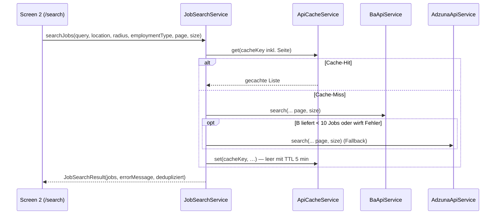

# Jobsuche – revised

Nachdem der E-Mail-Versand (Phasen A–F, siehe `14-Email.md`) abgeschlossen ist, folgt der **dritte Teil** der Job-O-Matic: die **Jobsuche**. Dieses Dokument bündelt den aktuellen Stand, priorisierte Verbesserungspotenziale und deren Umsetzungsstatus (Stand: **2026-09-04**).

> **Abgrenzung:** Die technische Tiefe der BA-JOBBÖRSE-API (Endpunkte, Query-Parameter, Response-Struktur) ist in `9-Jobsuche.md` dokumentiert, der allgemeine Stand in `10-aktueller_Stand.md`. Dieses Dokument arbeitet die daraus abgeleiteten Punkte ab und dient als laufendes Arbeitsdokument.

---

## 1. Aktueller Stand (2026-09-04)

Die Jobsuche ist **funktionsfähig**. In dieser Revision umgesetzt:

- **„Verbindung testen“ in der API-Key-Verwaltung** – der Button war ausgegraut, weil im Code `onPressed: null` gesetzt war (`// TODO: Implement connectivity test`). Ursache war also eine **fehlende Implementierung**, kein Konfigurationsproblem. Neu prüft `ApiConnectivityService` je Dienst per leichtem HTTP-Request (BA, Adzuna, SerpAPI, Brevo, Gemini, Mistral, Groq) und zeigt grün/rot/orange Ergebnisse inkl. Latenz.
- Suchergebnisse typisiert, URL/Beschreibung/Ort werden beim Übernehmen durchgereicht, WorkModel-Filter transparent, `ApiClient`-Retry-Kern mit `Retry-After`, gemeinsamer `JobOfferMapper`, Leerergebnis-Caching, stabile Scraper-IDs (FNV-1a), Pagination und URL-normalisierte Deduplizierung.

### 1.1 Komponenten

| Komponente | Datei | Status |
|---|---|---|
| BA-JOBBÖRSE-Client (Parsing über gemeinsamen Mapper) | `lib/data/services/api/ba_api_service.dart` | ✅ |
| Adzuna-Client (inkl. `workModel`-Ableitung aus Beschreibung; konfigurierbarer Markt + 401-`AUTH_FAIL`-Hinweis) | `lib/data/services/api/adzuna_api_service.dart` | ✅ |
| Orchestrierung BA → Adzuna (Kaskade, Dedup, Cache, `page`/`size`) | `lib/data/services/api/job_search_service.dart` | ✅ |
| HTTP-Client (Retry-Kern, `Retry-After`, Timeout, Key-Management) | `lib/data/services/api/api_client.dart` | ✅ |
| In-Memory-Cache (30 min TTL, LRU) | `lib/data/services/api/api_cache_service.dart` | ✅ |
| HTML-Scraping (stabile IDs via FNV-1a) | `lib/data/services/api/job_scraper_service.dart` | ✅ |
| UI Screen 2 – Suche, Übernahme, Pagination | `lib/presentation/screens/job_search_screen.dart` | ✅ |
| API-Key-Verwaltung mit Konnektivitäts-Test | `lib/presentation/screens/api_key_settings_screen.dart` | ✅ |
| Connectivity-Check-Dienst (neu) | `lib/data/services/api/api_connectivity_service.dart` | ✅ |
| Gemeinsamer Mapper/Format-Logik (neu) | `lib/data/services/api/job_offer_mapper.dart` | ✅ |
| Deterministischer Hash (neu) | `lib/data/services/api/stable_hash.dart` | ✅ |
| Modell | `lib/data/models/job_offer.dart` | ✅ |

### 1.2 Datenfluss


---

## 2. Verbesserungspotenziale – Status

| # | Bereich / Problem | Status (2026-09-04) |
|---|---|---|
| 1 | `JobSearchScreen._searchResults` ist stringly-typed | ✅ `List<JobOffer>` |
| 2 | URL/Beschreibung wird beim Übernehmen verworfen | ✅ `jobUrl`, `jobDescription`, Ort werden durchgereicht |
| 3 | WorkModel-Filter wirkungslos für BA | ✅ Filter nutzt `job.workModel` bzw. Beschreibung; „unbewertbar“ passiert transparent |
| 4 | Duplizierte Retry-Logik in `ApiClient` | ✅ gemeinsamer `_performWithRetry()`-Kern |
| 5 | `Retry-After`-Header ignoriert | ✅ ausgewertet (Sekunden oder HTTP-Datum), Fallback `5s × Versuch` |
| 6 | Cache nur in-memory | ⏳ **geprüft/entschieden:** bewusst beibehalten – Suchtreffer sind flüchtig; der TTL-Cache schützt die Rate-Limits ausreichend (Persistenz bleibt den Bewerbungsdaten in SQLite vorbehalten) |
| 7 | Leere Ergebnisse nicht gecacht | ✅ leere Treffer mit 5-min-TTL |
| 8 | Salär/Datum/Enum-Mapping dupliziert | ✅ `JobOfferMapper` (BA + Adzuna) |
| 9 | `hashCode`-IDs im Scraper | ✅ FNV-1a (`stable_hash.dart`), deterministisch und getestet |
| 10 | Kein `workModel`-Mapping | ✅ Adzuna ableitet aus Beschreibung; BA ohne Beschreibung „unbewertbar“ → transparent |
| 11 | Keine Pagination in der UI | ✅ `page`/`size` Ende-zu-Ende + „Weitere Ergebnisse laden“ |
| 12 | Sequenzielle Kaskade BA → Adzuna | ➖ **Entscheidung:** sequenziell beibehalten (Adzuna-Kontingent: nur bei < 10 BA-Treffern); Parallelmodus erst nach Verifikation des BA-Limits |
| 13 | Keine Beschreibung bei BA-Jobs | ⬜ **bewusst offen:** Jobdetails-Endpunkt `/pc/v4/jobdetails/{base64(refnr)}` ist noch unverifiziert → nicht umgesetzt |
| + | „Verbindung testen“-Button war ausgegraut | ✅ Ursache `onPressed: null` (TODO); `ApiConnectivityService` + Status-UI implementiert |

### 2.1 Tests

| Testdatei | Inhalt |
|---|---|
| `test/services/job_offer_mapper_test.dart` | parseDate, Gehalt, Beschäftigungsart, WorkModel |
| `test/services/api_connectivity_service_test.dart` | ok / nicht konfiguriert / HTTP-Fehler / Netzwerkfehler |
| `test/services/stable_hash_test.dart` | Determinismus, 31-Bit-Stabilität, Unterscheidbarkeit |
| `test/services/job_search_service_test.dart` | Seiten-Weiterleitung, Leerergebnis-Cache, Cache-Key je Seite, WorkModel-Durchlass |
| `test/services/ba_api_service_test.dart` | unverändert grün (Refactoring abgesichert) |

_Gesamt: 195 Tests grün (`flutter test`), keine neuen Analyzer-Fehler._
---

## 3. Umsetzungsnotizen (Auszug)

- **Typisierung (Punkte 1–2):** `_searchResults` ist `List<JobOffer>`; `_adoptResults(List<JobOffer>, {navigateToApplications})` reicht `job.url`, `job.description` und `job.location` an `JobRepository.addApplication(...)` durch (Signatur um `jobDescription`/`location` erweitert).
- **WorkModel-Filter (Punkt 3):** filtert bevorzugt über das modellierte Feld `job.workModel`, sonst über die Beschreibung (`JobOfferMapper.workModelFromDescription`); Jobs ohne Angabe passieren transparent – keine versteckten Ausschlüsse.
- **Retry-Kern (Punkte 4–5):** `ApiClient.get()/post()` delegieren an `_performWithRetry()`; bei HTTP 429 wird `Retry-After` respektiert (Sekunden oder HTTP-Datum), Fallback `5s × Versuch`; Timeout-Backoff `2s × Versuch`.
- **Cache (Punkt 7):** leere Ergebnisse werden mit 5-min-TTL gecacht, volle Treffer mit dem 30-min-Default.
- **Stabile IDs (Punkt 9):** `scrape_${fnv1a32('url|title')}` statt `hashCode` – deterministisch über Läufe/Plattformen.
- **Pagination (Punkt 11):** `searchJobs(... page, size)`; Cache-Key enthält die Seite; die UI zeigt „Weitere Ergebnisse laden“, solange eine volle Seite zurückkam.
- **Deduplizierung („Normieren“):** `_dedupeKey()` entfernt Tracking-/Query-Anteile der URL; Inhalts-Fallback (Titel+Firma+Ort) nur ohne URL – bewusst keine pauschale Inhalts-Verschmelzung über Portale (Falsch-Positiv-Risiko).

---

## 4. Checkliste

- [x] Konnektivitäts-Button implementiert (`ApiConnectivityService`, Status je Dienst, Spinner während des Tests)
- [x] Screen auf `List<JobOffer>` umgestellt; URL/Beschreibung/Ort übernehmen (Punkte 1–2)
- [x] WorkModel-Filter auf Felder gestützt bzw. transparent dokumentiert (Punkt 3)
- [x] `ApiClient`-Retry-Kern extrahiert inkl. `Retry-After`-Header (Punkte 4–5)
- [x] `JobOfferMapper` für gemeinsame Format-/Enum-/WorkModel-Logik (Punkte 8, 10)
- [x] Leere Ergebnisse mit kurzer TTL gecacht; Persistenz geprüft und entschieden (Punkte 6–7)
- [x] Stabile Job-ID via FNV-1a (Punkt 9)
- [x] Pagination in Screen 2 (Punkt 11)
- [x] URL-normalisierte Deduplizierung („Normieren“)
- [x] Adzuna-Markt konfigurierbar („Adzuna Land/Markt“, Default `de`); 401-`AUTH_FAIL`-Fehlermeldung mit Markt-Hinweis; Doku unter „Adzuna API Key“
- [ ] Optional offen: Jobdetails-Endpunkt für BA-Beschreibungen lazy nachladen (Punkt 13, bewusst zurückgestellt)

---

## 5. Offene Fragen / Risiken – Antworten & Status

| Frage | Antwort / Status |
|---|---|
| Tägliches/stündliches Request-Limit der BA-API? | ⏳ Offen („Kommt noch“): über Logs und den Konnektivitäts-Button beobachten. Cache (30 min / leer 5 min) puffert bereits; Kaskade bleibt bis zur Verifikation sequenziell. |
| Reicht die URL-Duplizierung (`seenUrls`)? | ✅ **„Normieren“ umgesetzt** – URLs werden normalisiert (Query-/Tracking-Parameter entfernt), Inhalts-Fallback nur ohne URL. Bewusst keine Inhalts-Verschmelzung über Portale hinweg. |
| Arbeitet `hashCode` stabil für persistierte IDs? | ✅ **„Testen und anpassen“ umgesetzt** – FNV-1a ersetzt `hashCode`; `stable_hash_test.dart` grün. |
| Soll die Kaskade parallelisiert werden? | ➖ **Entscheidung dokumentiert:** Antwort „Ja“ eingeordnet – Standard bleibt die sequenzielle Kaskade (Adzuna-Kontingent nur bei < 10 BA-Treffern). Optionaler Parallelmodus erst nach Verifikation des BA-Limits. |
| Rechtliche Zulässigkeit von Scraping? | ⏳ Extern („Prüfung läuft noch“) – Scraper bleibt reiner Fallback; keine Code-Änderung. |

**Warum war „Konnektivität prüfen“ ausgegraut?** Im `ApiKeySettingsScreen` war gesetzt:

```dart
FilledButton.icon(
  onPressed: null, // TODO: Implement connectivity test
  ...
)
```

`onPressed: null` lässt Flutter den Button im deaktivierten (grauen) Zustand rendern – die Funktion fehlte komplett. Jetzt läuft der Test über `ApiConnectivityService.checkAll()` (7 Dienste) und zeigt je Dienst `ok` / `nicht konfiguriert` / `Fehler` inkl. Latenz.

### Adzuna API Key

**Problem (geklärt, 2026-09-04):** Der über den Adzuna-Developer-Key generierte Key galt als „ungültig“. Verifiziert liefert Adzuna bei ungültigen/fehlenden Zugangsdaten **HTTP 401** mit Body `{"exception":"AUTH_FAIL","display":"Authorisation failed"}`. Die App meldete das bisher als generischen „Adzuna-API-Fehler“ bzw. im Konnektivitäts-Test als „Fehler (HTTP 401)“.

**Was muss man bei Adzuna eintragen (Beantragung):**
1. `developer.adzuna.com` → **Register** (Signup unter `/signup`): Username, E-Mail, Passwort, Organisation/Website, **„Your application of the Adzuna API“**, „Average Monthly Visitors“, **„Primary Market“** und „Primary Industry“.
2. Nach Anmeldung erhält man **zwei Werte**: `app_id` und `app_key`. Beide sind Pflicht.
3. Für Deutschland (`de`): Der freie Developer-Key deckt i. d. R. nur den gewählten „Primary Market“ ab. Ist `de` nicht freigeschaltet, schlägt auch ein korrekt eingegebener Key mit 401 `AUTH_FAIL` fehl → Zugang über `info@adzuna.com` anfragen (siehe Doku-Übersicht).

**Was muss im Projekt eintragen werden (damit es ein Match wird):**
- **Adzuna App-ID** = `app_id`, **Adzuna API-Key** = `app_key` (zwei getrennte Felder im Settings-Screen; gespeichert via `flutter_secure_storage`). Vertauschte Werte oder führende/nachgestellte Leerzeichen → 401.
- **Adzuna Land/Markt** (neu, ab dieser Revision): 2-Buchstaben-Ländercode, Standard `de`. Er bestimmt den `{country}`-Pfadanteil `https://api.adzuna.com/v1/api/jobs/{country}/search/{page}` und wird beim Konnektivitäts-Test und in der Suche pro Request ausgelesen (Änderung wirkt sofort). Ist für den eigenen Key nur UK freigeschaltet, `gb` wählen.
- Schnelltest ohne App: `https://api.adzuna.com/v1/api/jobs/de/search/1?app_id=…&app_key=…&what=flutter&results_per_page=1` → HTTP 200 = passt; HTTP 401 = Werte prüfen oder Markt nicht freigeschaltet.

**Umgesetzte Code-Änderungen:**
- `ApiKeyService`: `adzunaCountry`-Konstante + `loadAdzunaCountry()` (Default `de`) / `saveAdzunaCountry()`.
- `AdzunaApiService`: Land wird konfigurierbar geladen; **HTTP 401** wird gesondert mit klarer `AUTH_FAIL`-Meldung (inkl. Markt) geworfen.
- `ApiConnectivityService._checkAdzuna()`: nutzt das konfigurierte Land statt fest `de`.
- `ApiKeySettingsScreen`: neues Feld „Adzuna Land/Markt“ (Standard `de`, optional).

**Referenz:** Doku https://developer.adzuna.com/ (Overview/Search), Signup https://developer.adzuna.com/signup.


---

_Stand: 2026-09-04 — Revision abgearbeitet. Neu: Adzuna-Markt konfigurierbar (Default `de`) + 401-`AUTH_FAIL`-Fehlerbehandlung + Doku („Adzuna API Key“). Verbleibend: Punkt 13 (optional) sowie externe Fragen (BA-Limit, Scraping-Recht)._
